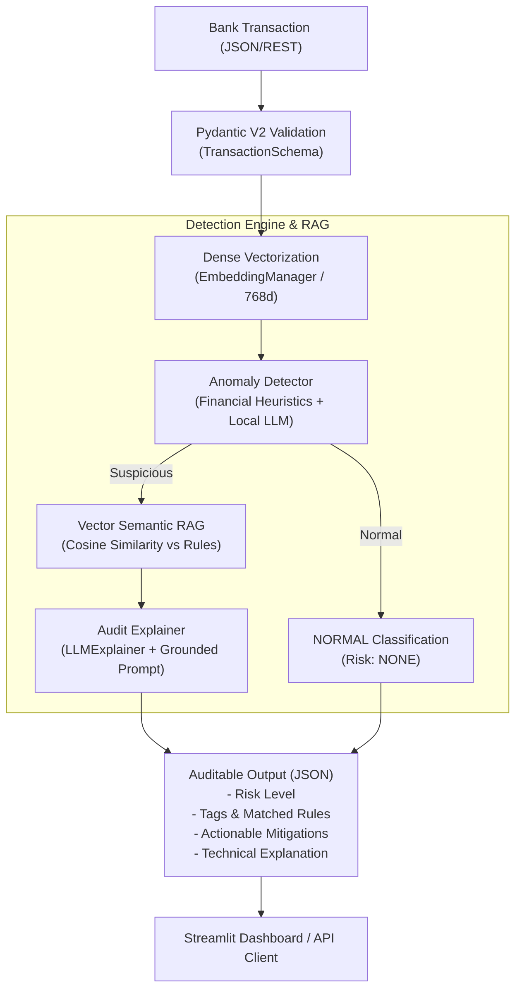

# Intelligent Financial Fraud Detection System with Vector RAG & Local LLM

[](https://github.com/raelcorrales/intelligent-fraud-detection-system-rag/releases/tag/v0.1.0)
[](https://python.org)
[](https://fastapi.tiangolo.com)
[](https://ollama.com)
[](tests/)

An end-to-end system for **financial fraud detection and auditable explainability**, combining dense semantic vector retrieval (**RAG** with cosine similarity), local large language models (**Ollama**), strongly typed REST APIs (**FastAPI**), and interactive analytics dashboards (**Streamlit**).

> Developed by **Rael Corrales** · Python Engineer & Data Specialist

-----

## 🏗️ System Architecture

The pipeline processes banking transactions via a high-resilience hybrid architecture designed for data sovereignty, low latency, and zero-hallucination compliance:



-----

## 🚀 Key Features

- **Dense Semantic Embeddings**: Normalized ($L_2$) 768-dimensional dense representations for transactions and business rules using local embedding models (`nomic-embed-text`).
- **Cosine Similarity RAG**: Real vector similarity retrieval ($\text{cosine similarity} \ge \tau$) over structured fraud rules (`fraud_rules.json`), ensuring grounded audit justifications.
- **Resilient Hybrid Detection**: Semantic reasoning via local LLM (`llama3.1` / `llama3.2`) paired with calibrated financial heuristics (account balance draining, brute-force login surges, and atypical execution speeds).
- **Fault-Tolerant Infrastructure**: Exponential backoff with random jitter in [`OllamaBase`](src/fraud_detection_service/ollama_base.py) with deterministic offline fallbacks for high availability.
- **Production REST API**: FastAPI endpoints (`/process-transaction/` and `/health`) enforced by strict Pydantic V2 contracts with interactive OpenAPI documentation (`/docs`).
- **Cybersecurity Analytics Dashboard**: Streamlit interface with transactional KPIs, USA state choropleth risk map, IP/device anomaly hotspots, and **t-SNE** high-dimensional cluster visualization.

-----

## 📁 Repository Structure

```
fraudai_project/
├── data/
│   ├── bank_transactions_data_2.csv    # Kaggle banking transactions dataset
│   ├── fraud_rules.json                # Structured fraud rules catalog
│   └── processed_transactions.jsonl    # Batch processed results
├── src/
│   ├── config.py                       # Centralized configuration and model settings
│   ├── transaction.py                  # Transaction domain entity
│   ├── process_function.py             # Inference pipeline orchestrator
│   ├── app_fraude.py                   # Streamlit analytics dashboard
│   └── fraud_detection_service/
│       ├── ollama_base.py              # Resilient base client with retries and jitter
│       ├── embedding_manager.py        # Vector embedding generation and normalization
│       ├── embedding_rule_utils.py     # Rule embedding vectorization and caching
│       ├── anomaly_detector.py         # Fraud anomaly detection (LLM + Heuristics)
│       ├── rag_retriever.py            # Vector RAG retriever with cosine similarity
│       └── llm_explainer.py            # Natural language audit report synthesizer
├── tests/
│   └── test_pipeline.py                # Automated test suite (pytest)
├── main_api.py                         # Production REST API with FastAPI
├── requirements.txt                    # Project dependencies
├── CHANGELOG.md                        # Historical release changelog
└── README.md
```

-----

## ⚙️ Quick Start

### 1. Install Dependencies

```bash
python -m pip install -r requirements.txt
```

### 2. Configure Models (Optional if running local Ollama)

If Ollama is installed on your machine, pull the recommended models:

```bash
ollama pull nomic-embed-text
ollama pull llama3.1
```

> **Offline Resilience Note**: If Ollama is not running, the system automatically activates deterministic vector and explanation fallbacks without crashing or raising unhandled exceptions.

### 3. Run Automated Tests

```bash
python -m pytest tests/test_pipeline.py -v
```

### 4. Run CLI Demo

```bash
python -m src.process_function
```

### 5. Launch REST API

```bash
python -m uvicorn main_api:app --reload --port 8000
```
- Interactive Swagger docs: [http://localhost:8000/docs](http://localhost:8000/docs)
- Health probe: [http://localhost:8000/health](http://localhost:8000/health)

### 6. Launch Streamlit Dashboard

```bash
python -m streamlit run src/app_fraude.py
```

-----

## 📦 Sample API Response

Request to `POST /process-transaction/`:

```json
{
  "TransactionID": "TXN_FRAUD_001",
  "TransactionAmount": 4200.0,
  "is_fraudulent": true,
  "detected_risk_level": "CRITICAL",
  "detected_rule_tags": ["financial", "authentication", "account_takeover"],
  "mitigation_steps": [
    "Require multi-factor authentication (MFA).",
    "Temporarily lock account.",
    "Contact customer via secure channel."
  ],
  "explanation": "Fraud Alert (CRITICAL): Transaction exhibits anomalous patterns tagged as [financial, authentication, account_takeover]. Audit rationale: A transaction consumes a very high proportion of the current account balance following multiple failed login attempts.",
  "matched_rules_details": [
    {
      "id": "RULE_006_LARGE_PERCENTAGE_OF_ACCOUNT_BALANCE",
      "risk_level": "CRITICAL",
      "similarity_score": 0.85,
      "description": "A transaction consumes a very high proportion of the current account balance..."
    }
  ],
  "transaction_embedding_shape": [768]
}
```

-----

## 📄 License & Author

Developed for architectural and demonstration purposes by **Rael Corrales**. Code released under the MIT License.