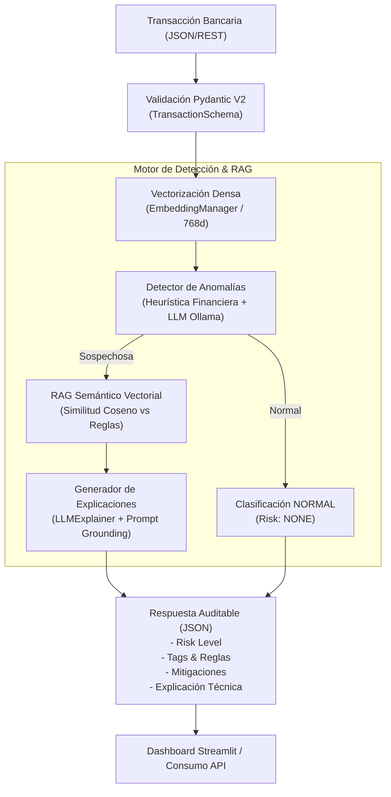

# Sistema Inteligente de Detección de Fraudes con RAG y LLM Local

[](https://github.com/)
[](https://python.org)
[](https://fastapi.tiangolo.com)
[](https://ollama.com)
[](tests/)

Sistema end-to-end de **detección de fraudes financieros y explicabilidad auditable** combinando recuperación semántica vectorial (**RAG** con similitud coseno), modelos de lenguaje local (**Ollama**), APIs REST fuertemente tipadas (**FastAPI**) y paneles de control analíticos (**Streamlit**).

> Desarrollado por **Rael Corrales** · Python Engineer & Data Specialist

-----

## 🏗️ Arquitectura del Sistema

El pipeline procesa transacciones bancarias mediante una arquitectura híbrida de alta resiliencia diseñada para privacidad bancaria y baja latencia:



-----

## 🚀 Características Principales

- **Embeddings Semánticos Reales**: Representación vectorial densa (768 dimensiones) de transacciones y reglas de negocio, con normalización $L_2$.
- **RAG con Similitud Coseno**: Búsqueda vectorial real ($\text{cosine similarity} \ge \tau$) sobre el catálogo de reglas bancarias (`fraud_rules.json`), asegurando justificaciones sin alucinaciones.
- **Detección Resiliente Híbrida**: Razonamiento con LLM local (`llama3.1` / `llama3.2`) complementado con heurísticas financieras calibradas (ratios de balance, ataques de fuerza bruta y tiempos atípicos).
- **Tolerancia a Fallos & Backoff Exponencial**: Capa [`OllamaBase`](src/fraud_detection_service/ollama_base.py) con reintentos exponenciales con jitter y fallbacks estructurados para máxima disponibilidad.
- **API REST con FastAPI**: Endpoints `/process-transaction/` y `/health` con contratos de validación estrictos vía Pydantic V2 y documentación OpenAPI interactiva (`/docs`).
- **Dashboard de Ciberseguridad**: Interfaz en Streamlit con KPIs transaccionales, mapa coroplético por estado (USA), hotspots de IPs y dispositivos, y reducción de dimensionalidad con **t-SNE**.

-----

## 📁 Estructura del Proyecto

```
fraudai_project/
├── data/
│   ├── bank_transactions_data_2.csv    # Dataset bancario de Kaggle
│   ├── fraud_rules.json                # Catálogo de reglas de fraude estructuradas
│   └── processed_transactions.jsonl    # Salida por lotes procesada
├── src/
│   ├── config.py                       # Configuración unificada de modelos y rutas
│   ├── transaction.py                  # Entidad de dominio Transaction
│   ├── process_function.py             # Orquestador del pipeline de inferencia
│   ├── app_fraude.py                   # Dashboard analítico de Streamlit
│   └── fraud_detection_service/
│       ├── ollama_base.py              # Cliente base resiliente con reintentos y jitter
│       ├── embedding_manager.py        # Generación y normalización de embeddings
│       ├── embedding_rule_utils.py     # Vectorización y caching en memoria de reglas
│       ├── anomaly_detector.py         # Detección de fraude (LLM + Heurística)
│       ├── rag_retriever.py            # Búsqueda vectorial RAG por similitud coseno
│       └── llm_explainer.py            # Síntesis de explicaciones en lenguaje natural
├── tests/
│   └── test_pipeline.py                # Suite completa de tests unitarios (pytest)
├── main_api.py                         # API REST de producción con FastAPI
├── requirements.txt                    # Dependencias del proyecto
└── README.md
```

-----

## ⚙️ Puesta en Marcha Rápida

### 1. Instalación de Dependencias

```bash
python -m pip install -r requirements.txt
```

### 2. Configuración de Modelos (Opcional si usas Ollama local)

Si cuentas con Ollama instalado, descarga los modelos recomendados:

```bash
ollama pull nomic-embed-text
ollama pull llama3.1
```

> **Nota de Resiliencia**: Si Ollama no está en ejecución, el sistema activa automáticamente sus fallbacks semánticos y deterministas sin interrumpir la operación ni arrojar excepciones no controladas.

### 3. Ejecución de Tests Automatizados

```bash
python -m pytest tests/test_pipeline.py -v
```

### 4. Prueba Rápida por Consola (CLI)

```bash
python -m src.process_function
```

### 5. Levantar la API REST

```bash
python -m uvicorn main_api:app --reload --port 8000
```
- Documentación Swagger interactiva: [http://localhost:8000/docs](http://localhost:8000/docs)
- Health check: [http://localhost:8000/health](http://localhost:8000/health)

### 6. Levantar el Dashboard de Streamlit

```bash
python -m streamlit run src/app_fraude.py
```

-----

## 📦 Ejemplo de Respuesta API

Petición a `POST /process-transaction/`:

```json
{
  "TransactionID": "TXN_FRAUD_001",
  "TransactionAmount": 4200.0,
  "is_fraudulent": true,
  "detected_risk_level": "CRITICAL",
  "detected_rule_tags": ["financial", "authentication", "account_takeover"],
  "mitigation_steps": [
    "Requerir verificación multifactor (MFA).",
    "Bloquear cuenta temporalmente.",
    "Contactar al cliente a través de un canal seguro."
  ],
  "explanation": "Alerta de Fraude (CRITICAL): La transacción presenta patrones sospechosos etiquetados como [financial, authentication, account_takeover]. Fundamento de auditoría: Transacciones de monto significativamente alto en una categoría inusual y consumo de más del 70% del balance de la cuenta tras múltiples intentos de login.",
  "matched_rules_details": [
    {
      "id": "RULE_006_LARGE_PERCENTAGE_OF_ACCOUNT_BALANCE",
      "risk_level": "CRITICAL",
      "similarity_score": 0.85,
      "description": "Una transacción consume una proporción muy alta del balance actual de la cuenta..."
    }
  ],
  "transaction_embedding_shape": [768]
}
```

-----

## 📄 Licencia y Autores

Proyecto desarrollado con fines demostrativos y de arquitectura por **Rael Corrales**. Código bajo licencia MIT.